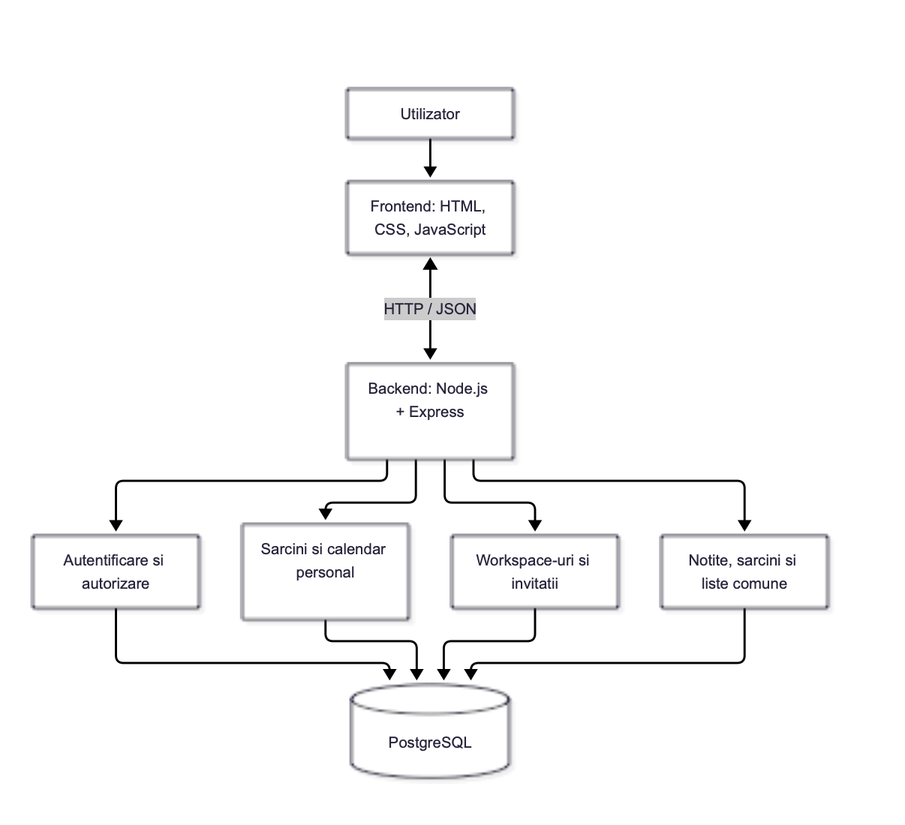

DailyHub - Arhitectura aplicației

DESCRIERE GENERALĂ

DailyHub este o aplicație web destinată organizării activităților cotidiene, atât individual, cât și în colaborare cu alți utilizatori.

Aplicația va utiliza o arhitectură de tip client-server, organizată în trei componente principale: frontend, backend și bază de date.

Această separare permite dezvoltarea, testarea și întreținerea independentă a interfeței, logicii aplicației și stocării datelor.

ARHITECTURA GENERALĂ

Aplicația va fi structurată pe trei niveluri:

Frontend - Interfața prin care utilizatorii interacționează cu aplicația.

Backend - Componenta care procesează cererile, aplică regulile aplicației și gestionează accesul la date.

Bază de date - Componenta care stochează persistent informațiile utilizatorilor și ale Workspace-urilor.

Frontend-ul comunică cu backend-ul prin cereri HTTP, iar backend-ul comunică cu baza de date prin interogări SQL.

COMPONENTA FRONTEND

Tehnologii propuse:
HTML, CSS și JavaScript.

Frontend-ul reprezintă partea vizibilă a aplicației și permite utilizatorilor să acceseze funcționalitățile DailyHub.

Responsabilități principale:

- Afișarea paginilor de autentificare și înregistrare.
- Afișarea Dashboard-ului.
- Gestionarea vizuală a sarcinilor personale.
- Afișarea calendarului și a evenimentelor personale.
- Navigarea între Workspace-uri.
- Afișarea sarcinilor, notițelor și listelor colaborative.
- Afișarea și gestionarea invitațiilor primite.
- Validarea inițială a formularelor.
- Trimiterea cererilor către backend și afișarea răspunsurilor.

Comunicarea cu backend-ul va fi realizată prin funcția fetch din JavaScript, folosind cereri HTTP și date în format JSON.

COMPONENTA BACKEND

Tehnologii propuse:
Node.js și Express.

Backend-ul este responsabil de procesarea cererilor, implementarea regulilor aplicației și comunicarea cu baza de date.

Responsabilități principale:

- Înregistrarea și autentificarea utilizatorilor.
- Gestionarea autentificării și a sesiunilor.
- Verificarea drepturilor de acces.
- Gestionarea sarcinilor și evenimentelor personale.
- Crearea și administrarea Workspace-urilor.
- Gestionarea invitațiilor și a membrilor.
- Gestionarea notițelor și listelor colaborative.
- Validarea datelor primite.
- Executarea operațiilor asupra bazei de date.
- Returnarea răspunsurilor și a mesajelor de eroare.

Backend-ul va expune un API REST.

Principalele metode HTTP utilizate vor fi:

GET - Obținerea informațiilor.
POST - Crearea informațiilor.
PUT sau PATCH - Actualizarea informațiilor.
DELETE - Ștergerea informațiilor.

Mecanismul exact de gestionare a sesiunilor va fi stabilit în etapa de implementare.

COMPONENTA BAZĂ DE DATE

Tehnologie propusă:
PostgreSQL.

Baza de date va asigura stocarea persistentă a informațiilor aplicației.

Principalele categorii de date vor fi:

- Utilizatori.
- Sarcini personale.
- Evenimente și rezervări personale.
- Workspace-uri.
- Membri ai Workspace-urilor.
- Invitații.
- Notițe comune.
- Sarcini comune.
- Liste colaborative.
- Elemente ale listelor.

Entitățile vor avea identificatori unici și vor fi conectate prin relații definite cu ajutorul cheilor externe.

Structura detaliată a tabelelor și relațiilor va fi prezentată în documentul data-model.md.

COMUNICAREA DINTRE COMPONENTE

Frontend-ul nu va accesa direct baza de date.

Toate operațiile de citire, creare, modificare și ștergere vor fi efectuate prin backend.

Exemplu - Crearea unei sarcini personale

Pasul 1 - Utilizatorul completează formularul pentru crearea unei sarcini.

Pasul 2 - Frontend-ul trimite către backend o cerere HTTP POST care conține datele sarcinii în format JSON.

Pasul 3 - Backend-ul verifică autentificarea utilizatorului și validează informațiile primite.

Pasul 4 - Backend-ul execută operația necesară în baza de date PostgreSQL.

Pasul 5 - Baza de date confirmă salvarea informațiilor.

Pasul 6 - Backend-ul returnează un răspuns HTTP către frontend.

Pasul 7 - Frontend-ul actualizează lista sarcinilor și afișează rezultatul.

Exemplu - Acceptarea unei invitații într-un Workspace

Pasul 1 - Utilizatorul accesează secțiunea Invitații.

Pasul 2 - Frontend-ul solicită backend-ului invitațiile asociate utilizatorului autentificat.

Pasul 3 - Backend-ul citește invitațiile din baza de date.

Pasul 4 - Utilizatorul acceptă o invitație.

Pasul 5 - Frontend-ul trimite cererea de acceptare către backend.

Pasul 6 - Backend-ul verifică dacă invitația aparține utilizatorului și este încă în așteptare.

Pasul 7 - Backend-ul actualizează invitația și adaugă utilizatorul în lista membrilor Workspace-ului, folosind o tranzacție în baza de date.

Pasul 8 - Aplicația confirmă operația și afișează noul Workspace.

SECURITATE ȘI CONTROLUL ACCESULUI

Fiecare utilizator va avea acces la propriile date personale.

Informațiile unui Workspace vor putea fi accesate doar de membrii acestuia.

Administratorul unui Workspace va putea invita și elimina membri.

Membrii obișnuiți vor putea utiliza funcționalitățile colaborative, fără drepturi de administrare a membrilor.

Backend-ul va verifica autentificarea și permisiunile pentru fiecare operație protejată.

Parolele vor fi stocate folosind un algoritm securizat de hashing, nu în text simplu.

Datele introduse de utilizatori vor fi validate pe server.

Interogările SQL vor fi parametrizate pentru a reduce riscul atacurilor de tip SQL Injection.

ORGANIZAREA PROIECTULUI

Codul aplicației va fi organizat în directoare separate pentru frontend, backend și documentație.

Frontend-ul va conține paginile HTML, fișierele CSS și modulele JavaScript.

Backend-ul va conține rutele API, controllerele, serviciile, middleware-ul și componenta de acces la baza de date.

Documentația va fi păstrată în directorul docs.

Această organizare va facilita lucrul în echipă și dezvoltarea independentă a modulelor.

EXTINDEREA APLICAȚIEI

Arhitectura modulară va permite adăugarea ulterioară a unor funcționalități suplimentare:

- Calendar comun pentru Workspace-uri.
- Partajarea orarelor săptămânale.
- Gestionarea bugetelor personale.
- Încărcarea și organizarea documentelor.
- Planificarea avansată a activităților de grup.

Aceste funcționalități vor fi implementate după dezvoltarea modulelor esențiale.

CONCLUZIE

DailyHub va utiliza o arhitectură client-server cu trei componente principale: frontend, backend și bază de date.

Frontend-ul va fi dezvoltat folosind HTML, CSS și JavaScript, backend-ul va utiliza Node.js și Express, iar informațiile vor fi stocate în PostgreSQL.

Comunicarea dintre frontend și backend se va realiza printr-un API REST, folosind cereri HTTP și date în format JSON.

Separarea responsabilităților va permite dezvoltarea graduală a aplicației și extinderea acesteia cu noi funcționalități.
